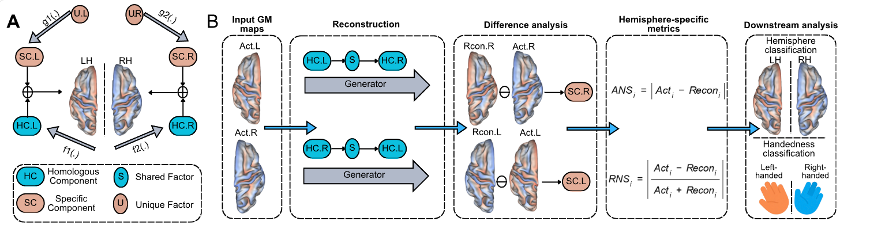

---
hide:
  - navigation
  - toc
---

  

    
Hemisphere-specific neuroimaging toolkit

    <h1>HemiSpec</h1>
    
HemiSpec is a research-software toolkit for converting preprocessed gray-matter maps into bilateral reconstruction-derived hemispheric measures: <strong>ANS</strong> (absolute neuroanatomical specificity) and <strong>RNS</strong> (relative neuroanatomical specificity).

    

      <a class="md-button md-button--primary" href="quickstart/">Quick start</a>
      <a class="md-button" href="input-preprocessing/">Input &amp; preprocessing</a>
      <a class="hs-textlink-inline" href="installation/">Installation →</a>
    

    

      
      by <strong>阿瞒的脑洞 · A MAN'S BRAINHOLE</strong>
    

  

  

    
Asymmetry metrics

    

      ANS
      <code>|Acti − Reconi|</code>
    

    

      RNS
      <code>|(Acti − Reconi) / (Acti + Reconi)|</code>
    

    
Wang et al. 2024, <a href="https://doi.org/10.1016/j.patter.2024.100930">Patterns 5:100930</a>

  

  
Input boundary

  
HemiSpec does <strong>not</strong> accept raw T1-weighted MRI directly as DGN input. First convert each T1 image into an MNI152 1.5 mm masked gray-matter map (<code>*_GM_masked.nii.gz</code>) using the documented FSL preprocessing workflow.

<h2 class="hs-section-title">End-to-end workflow</h2>

  <article class="hs-step">
    01
    <h3>Prepare the input</h3>
    
T1w NIfTI → FSL BET, FAST, affine MNI registration, GM threshold and mask → masked GM map.

  </article>
  <article class="hs-step">
    02
    <h3>Reconstruct both directions</h3>
    
The packaged bilateral DGN performs left-to-right and right-to-left inference on the same preprocessed gray-matter grid.

  </article>
  <article class="hs-step">
    03
    <h3>Compute ANS and RNS</h3>
    
Voxel-wise comparison yields ANS and RNS; both directions merge into bilateral target-hemisphere maps.

  </article>
  <article class="hs-step">
    04
    <h3>Summarize or validate</h3>
    
Optionally aggregate with a compatible atlas, run hemisphere-classifier validation, or estimate test–retest reliability.

  </article>

ANS and RNS are non-negative reconstruction-error-derived quantities, not distances in millimetres, and not direct measurements of neuronal function, causal lateralization, or tissue pathology. The published definitions come from Wang et al. (2024); see <a href="methods/ans-rns-metrics/">ANS and RNS metrics</a> for the exact software interpretation.

<h2 class="hs-section-title">The method at a glance</h2>

  <figure class="hs-figure">
    
    <figcaption>Conceptual reconstruction framework and ANS/RNS definitions from Wang et al. (2024). HemiSpec starts from FSL-preprocessed GM maps. ANS/RNS are non-negative GM-derived measures, not distances in millimetres.</figcaption>
  </figure>
  

  <table>
    <thead>
      <tr><th>Stage</th><th>Input</th><th>Main operation</th><th>Output</th></tr>
    </thead>
    <tbody>
      <tr><td>Preprocessing</td><td>T1-weighted NIfTI</td><td>FSL brain extraction, tissue segmentation, affine MNI registration, GM threshold/mask</td><td><code>*_GM_masked.nii.gz</code></td></tr>
      <tr><td>Reconstruction</td><td>Preprocessed GM map</td><td>Left-to-right and right-to-left DGN inference</td><td>Reconstructed target hemispheres</td></tr>
      <tr><td>Metric computation</td><td>Actual and reconstructed GM</td><td>ANS/RNS residual metrics</td><td><code>ANS.L</code>, <code>ANS.R</code>, <code>RNS.L</code>, <code>RNS.R</code> maps</td></tr>
      <tr><td>Optional summaries</td><td>Voxel maps + compatible atlas</td><td>ROI aggregation</td><td>Long and wide ROI tables</td></tr>
      <tr><td>Optional validation</td><td>Maps/ROI features</td><td>Hemisphere classification and/or TRT analysis</td><td>Validation tables and plots</td></tr>
    </tbody>
  </table>

<h2 class="hs-section-title">Original method vs HemiSpec additions</h2>

  <section class="hs-compare__card hs-compare__card--original">
    
Original method (Wang et al. 2024)

    <ul>
      <li><svg class="hs-check" viewBox="0 0 24 24" aria-hidden="true"><path fill="currentColor" d="M9 16.17 4.83 12l-1.42 1.41L9 19 21 7l-1.41-1.41z"/></svg>Cross-hemispheric DGN reconstruction framework</li>
      <li><svg class="hs-check" viewBox="0 0 24 24" aria-hidden="true"><path fill="currentColor" d="M9 16.17 4.83 12l-1.42 1.41L9 19 21 7l-1.41-1.41z"/></svg>ANS and RNS definitions</li>
      <li><svg class="hs-check" viewBox="0 0 24 24" aria-hidden="true"><path fill="currentColor" d="M9 16.17 4.83 12l-1.42 1.41L9 19 21 7l-1.41-1.41z"/></svg>Published scientific evidence and terminology</li>
    </ul>
  </section>
  <section class="hs-compare__card hs-compare__card--added">
    
Added by HemiSpec

    <ul>
      <li><svg class="hs-check" viewBox="0 0 24 24" aria-hidden="true"><path fill="currentColor" d="M9 16.17 4.83 12l-1.42 1.41L9 19 21 7l-1.41-1.41z"/></svg>Installable API, CLI, and GUI workflow</li>
      <li><svg class="hs-check" viewBox="0 0 24 24" aria-hidden="true"><path fill="currentColor" d="M9 16.17 4.83 12l-1.42 1.41L9 19 21 7l-1.41-1.41z"/></svg>Model-asset discovery and bilateral map export</li>
      <li><svg class="hs-check" viewBox="0 0 24 24" aria-hidden="true"><path fill="currentColor" d="M9 16.17 4.83 12l-1.42 1.41L9 19 21 7l-1.41-1.41z"/></svg>ROI summaries, validation utilities, documentation, and release tooling</li>
    </ul>
  </section>

<h2 class="hs-section-title">Choose your path</h2>

  <a class="hs-path" href="quickstart/">
    <svg class="hs-path__icon" viewBox="0 0 24 24" aria-hidden="true"><path fill="currentColor" d="M9.19 6.35c-2.04 2.29-3.44 5.58-3.57 5.89L2 10.69l4.05-4.05c.47-.47 1.15-.68 1.81-.55l1.33.26zM11.17 17s3.74-1.55 5.89-3.7c5.4-5.4 4.5-9.62 4.21-10.57-.95-.29-5.17-1.19-10.57 4.21-2.15 2.15-3.7 5.89-3.7 5.89L11.17 17zm6.48-11.48c.78-.78 2.05-.78 2.83 0 .78.78.78 2.05 0 2.83-.78.78-2.05.78-2.83 0-.78-.78-.78-2.05 0-2.83zM3.5 18.5c1.5-1.5 4.5-1.5 6 0-1.5 1.5-1.5 4.5 0 6-1.5-1.5-4.5-1.5-6 0 1.5-1.5 1.5-4.5 0-6z"/></svg>
    <h3>Quick start</h3>
    
Install the source checkout, inspect model readiness, and run the GUI or bilateral CLI.

  </a>
  <a class="hs-path" href="methods/">
    <svg class="hs-path__icon" viewBox="0 0 24 24" aria-hidden="true"><path fill="currentColor" d="M21 5c-1.11-.35-2.33-.5-3.5-.5-1.95 0-4.05.4-5.5 1.5-1.45-1.1-3.55-1.5-5.5-1.5S2.45 4.9 1 6v14.65c0 .25.25.5.5.5.1 0 .15-.05.25-.1C3.1 20.45 5.05 20 6.5 20c1.95 0 4.05.4 5.5 1.5 1.35-.85 3.8-1.5 5.5-1.5 1.65 0 3.35.3 4.75 1.05.1.05.15.1.25.1.25 0 .5-.25.5-.5V6c-.6-.45-1.25-.75-2-1zM21 18.5c-1.1-.35-2.3-.5-3.5-.5-1.7 0-4.15.65-5.5 1.5V8c1.35-.85 3.8-1.5 5.5-1.5 1.2 0 2.4.15 3.5.5v11.5z"/></svg>
    <h3>Methods</h3>
    
Read the reconstruction framework, metric definitions, and implementation details.

  </a>
  <a class="hs-path" href="data-and-models/">
    <svg class="hs-path__icon" viewBox="0 0 24 24" aria-hidden="true"><path fill="currentColor" d="M10 4H4c-1.1 0-2 .9-2 2v12c0 1.1.9 2 2 2h16c1.1 0 2-.9 2-2V8c0-1.1-.9-2-2-2h-8l-2-2z"/></svg>
    <h3>Data and models</h3>
    
Learn how DGN checkpoints, classifier bundles, and optional ROI atlases are resolved.

  </a>

<h2 class="hs-section-title">How to cite</h2>

  
If you use HemiSpec, cite the original framework and record the software release.

  
Wang, G., Jiang, N., Ma, Y., Suo, D., Liu, T., Funahashi, S., &amp; Yan, T. (2024). Using a deep generation network reveals neuroanatomical specificity in hemispheres. <em>Patterns, 5</em>(4), 100930.

  
Paper DOI: <a class="hs-doi" href="https://doi.org/10.1016/j.patter.2024.100930">10.1016/j.patter.2024.100930</a> · Zenodo record: <a class="hs-doi" href="https://doi.org/10.5281/zenodo.10466961">10.5281/zenodo.10466961</a>

  
For software and downstream citations, see <a href="citation/">Citation</a>.

<h2 class="hs-section-title">Current scope</h2>

  

    <section class="hs-scope__col hs-scope__yes">
      <h3>Supported now</h3>
      <ul>
        <li><svg class="hs-scope__icon" viewBox="0 0 24 24" aria-hidden="true"><path fill="currentColor" d="M9 16.17 4.83 12l-1.42 1.41L9 19 21 7l-1.41-1.41z"/></svg>Voxel-wise ANS and RNS maps</li>
        <li><svg class="hs-scope__icon" viewBox="0 0 24 24" aria-hidden="true"><path fill="currentColor" d="M9 16.17 4.83 12l-1.42 1.41L9 19 21 7l-1.41-1.41z"/></svg>Optional ROI tables when an atlas on the input grid is available</li>
        <li><svg class="hs-scope__icon" viewBox="0 0 24 24" aria-hidden="true"><path fill="currentColor" d="M9 16.17 4.83 12l-1.42 1.41L9 19 21 7l-1.41-1.41z"/></svg>Optional hemisphere-classifier validation with the compatible Glasser atlas and labels</li>
        <li><svg class="hs-scope__icon" viewBox="0 0 24 24" aria-hidden="true"><path fill="currentColor" d="M9 16.17 4.83 12l-1.42 1.41L9 19 21 7l-1.41-1.41z"/></svg>Optional test–retest reliability</li>
        <li><svg class="hs-scope__icon" viewBox="0 0 24 24" aria-hidden="true"><path fill="currentColor" d="M9 16.17 4.83 12l-1.42 1.41L9 19 21 7l-1.41-1.41z"/></svg>Source checkout installation; the PyPI project is not public yet</li>
      </ul>
    </section>
    <section class="hs-scope__col hs-scope__no">
      <h3>Not in scope</h3>
      <ul>
        <li><svg class="hs-scope__icon" viewBox="0 0 24 24" aria-hidden="true"><path fill="currentColor" d="M19 13H5v-2h14v2z"/></svg>Raw T1-weighted images as direct DGN input</li>
        <li><svg class="hs-scope__icon" viewBox="0 0 24 24" aria-hidden="true"><path fill="currentColor" d="M19 13H5v-2h14v2z"/></svg>Behavioral-phenotype modeling as a built-in command</li>
        <li><svg class="hs-scope__icon" viewBox="0 0 24 24" aria-hidden="true"><path fill="currentColor" d="M19 13H5v-2h14v2z"/></svg>Anatomical interpretation of synthetic quickstart outputs</li>
        <li><svg class="hs-scope__icon" viewBox="0 0 24 24" aria-hidden="true"><path fill="currentColor" d="M19 13H5v-2h14v2z"/></svg>Unpublished study results</li>
      </ul>
    </section>
  

  

    
<strong>Source of truth.</strong> This site documents the current <code>main</code> checkout. The archived <code>v0.1.0</code> release predates some commands shown here.

    
<strong>Runs.</strong> Use a new or empty output directory for each run. The GUI refuses to start when the output workspace already contains entries. In the CLI, <code>hemispec quickstart</code> refuses a non-empty <code>--out-dir</code> unless you pass <code>--force</code>, which deletes and regenerates that directory; <code>hemispec workflow</code> and the single-step commands do not check, so choose a fresh folder yourself.

  

HemiSpec · by <strong>阿瞒的脑洞 · A MAN'S BRAINHOLE</strong> · Source: <a href="https://github.com/mqqq333/HemiSpec">github.com/mqqq333/HemiSpec</a> · Documentation built with <a href="https://squidfunk.github.io/mkdocs-material/">Material for MkDocs</a>.

