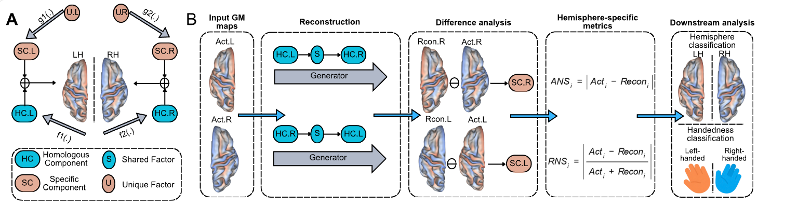

---
hide:
  - navigation
  - toc
---

  

    
半球特异性神经影像工具包

    <h1>HemiSpec</h1>
    
HemiSpec 是一个科研软件工具包，将预处理后的灰质图转换为双侧重建衍生的半球指标：<strong>ANS</strong>（absolute neuroanatomical specificity，绝对神经解剖特异性）与 <strong>RNS</strong>（relative neuroanatomical specificity，相对神经解剖特异性）。

    

      <a class="md-button md-button--primary" href="quickstart/">快速开始</a>
      <a class="md-button" href="input-preprocessing/">输入与预处理</a>
      <a class="hs-textlink-inline" href="installation/">安装 →</a>
    

    

      
      由 <strong>阿瞒的脑洞 · A MAN'S BRAINHOLE</strong> 出品
    

  

  

    
非对称指标

    

      ANS
      <code>|Acti − Reconi|</code>
    

    

      RNS
      <code>|(Acti − Reconi) / (Acti + Reconi)|</code>
    

    
Wang et al. 2024, <a href="https://doi.org/10.1016/j.patter.2024.100930">Patterns 5:100930</a>

  

  
输入边界

  
HemiSpec 的 DGN <strong>不能直接接收原始 T1 加权 MRI</strong>。每个 T1 图像必须先通过文档中的 FSL 预处理流程，转换为 MNI152 1.5 mm 空间的掩膜灰质图（<code>*_GM_masked.nii.gz</code>）。

<h2 class="hs-section-title">端到端工作流</h2>

  <article class="hs-step">
    01
    <h3>准备输入</h3>
    
T1w NIfTI → FSL BET、FAST、MNI 仿射配准、灰质阈值与掩膜 → 掩膜灰质图。

  </article>
  <article class="hs-step">
    02
    <h3>双向重建</h3>
    
随包提供的双侧 DGN 在同一预处理灰质网格上执行左到右与右到左推理。

  </article>
  <article class="hs-step">
    03
    <h3>计算 ANS 与 RNS</h3>
    
逐体素比较得到 ANS 与 RNS；两个方向合并为目标半球的双侧指标图。

  </article>
  <article class="hs-step">
    04
    <h3>汇总或验证</h3>
    
可选地使用兼容 atlas 聚合、运行半球分类器验证，或估计重测信度。

  </article>

ANS 与 RNS 是非负的重建误差衍生指标，既不是以毫米计量的距离，也不是神经元功能、因果偏侧化或组织病理的直接测量。原始定义来自 Wang 等人（2024）；精确的软件实现解释见 <a href="methods/ans-rns-metrics/">ANS/RNS 指标</a>。

<h2 class="hs-section-title">方法一览</h2>

  <figure class="hs-figure">
    
    <figcaption>基于 Wang 等人（2024）重建框架与 ANS/RNS 定义的原理示意。HemiSpec 从 FSL 预处理后的 GM 图开始；ANS/RNS 为非负的 GM 衍生指标，不是以毫米计量的距离。</figcaption>
  </figure>
  

  <table>
    <thead>
      <tr><th>阶段</th><th>输入</th><th>主要处理</th><th>输出</th></tr>
    </thead>
    <tbody>
      <tr><td>预处理</td><td>T1 加权 NIfTI</td><td>FSL 去颅骨、组织分割、MNI 仿射配准、GM 阈值与掩膜</td><td><code>*_GM_masked.nii.gz</code></td></tr>
      <tr><td>重建</td><td>预处理 GM 图</td><td>左到右与右到左 DGN 推理</td><td>目标半球重建图</td></tr>
      <tr><td>指标计算</td><td>实际 GM 与重建 GM</td><td>ANS/RNS 残差指标</td><td><code>ANS.L</code>、<code>ANS.R</code>、<code>RNS.L</code>、<code>RNS.R</code></td></tr>
      <tr><td>可选汇总</td><td>体素图 + 兼容 atlas</td><td>ROI 聚合</td><td>ROI 长表与宽表</td></tr>
      <tr><td>可选验证</td><td>图或 ROI 特征</td><td>半球分类和/或 TRT 分析</td><td>验证表格与图</td></tr>
    </tbody>
  </table>

<h2 class="hs-section-title">原始方法与 HemiSpec 新增</h2>

  <section class="hs-compare__card hs-compare__card--original">
    
原始方法（Wang et al. 2024）

    <ul>
      <li><svg class="hs-check" viewBox="0 0 24 24" aria-hidden="true"><path fill="currentColor" d="M9 16.17 4.83 12l-1.42 1.41L9 19 21 7l-1.41-1.41z"/></svg>跨半球 DGN 重建框架</li>
      <li><svg class="hs-check" viewBox="0 0 24 24" aria-hidden="true"><path fill="currentColor" d="M9 16.17 4.83 12l-1.42 1.41L9 19 21 7l-1.41-1.41z"/></svg>ANS 与 RNS 定义</li>
      <li><svg class="hs-check" viewBox="0 0 24 24" aria-hidden="true"><path fill="currentColor" d="M9 16.17 4.83 12l-1.42 1.41L9 19 21 7l-1.41-1.41z"/></svg>已发表科学证据与术语</li>
    </ul>
  </section>
  <section class="hs-compare__card hs-compare__card--added">
    
HemiSpec 新增

    <ul>
      <li><svg class="hs-check" viewBox="0 0 24 24" aria-hidden="true"><path fill="currentColor" d="M9 16.17 4.83 12l-1.42 1.41L9 19 21 7l-1.41-1.41z"/></svg>可安装的 API、CLI 与 GUI 工作流</li>
      <li><svg class="hs-check" viewBox="0 0 24 24" aria-hidden="true"><path fill="currentColor" d="M9 16.17 4.83 12l-1.42 1.41L9 19 21 7l-1.41-1.41z"/></svg>模型资产发现与双侧图导出</li>
      <li><svg class="hs-check" viewBox="0 0 24 24" aria-hidden="true"><path fill="currentColor" d="M9 16.17 4.83 12l-1.42 1.41L9 19 21 7l-1.41-1.41z"/></svg>ROI 汇总、验证工具、文档与发布流程</li>
    </ul>
  </section>

<h2 class="hs-section-title">选择使用路径</h2>

  <a class="hs-path" href="quickstart/">
    <svg class="hs-path__icon" viewBox="0 0 24 24" aria-hidden="true"><path fill="currentColor" d="M9.19 6.35c-2.04 2.29-3.44 5.58-3.57 5.89L2 10.69l4.05-4.05c.47-.47 1.15-.68 1.81-.55l1.33.26zM11.17 17s3.74-1.55 5.89-3.7c5.4-5.4 4.5-9.62 4.21-10.57-.95-.29-5.17-1.19-10.57 4.21-2.15 2.15-3.7 5.89-3.7 5.89L11.17 17zm6.48-11.48c.78-.78 2.05-.78 2.83 0 .78.78.78 2.05 0 2.83-.78.78-2.05.78-2.83 0-.78-.78-.78-2.05 0-2.83zM3.5 18.5c1.5-1.5 4.5-1.5 6 0-1.5 1.5-1.5 4.5 0 6-1.5-1.5-4.5-1.5-6 0 1.5-1.5 1.5-4.5 0-6z"/></svg>
    <h3>快速开始</h3>
    
安装源码检出，检查模型就绪状态，运行 GUI 或双向 CLI。

  </a>
  <a class="hs-path" href="methods/">
    <svg class="hs-path__icon" viewBox="0 0 24 24" aria-hidden="true"><path fill="currentColor" d="M21 5c-1.11-.35-2.33-.5-3.5-.5-1.95 0-4.05.4-5.5 1.5-1.45-1.1-3.55-1.5-5.5-1.5S2.45 4.9 1 6v14.65c0 .25.25.5.5.5.1 0 .15-.05.25-.1C3.1 20.45 5.05 20 6.5 20c1.95 0 4.05.4 5.5 1.5 1.35-.85 3.8-1.5 5.5-1.5 1.65 0 3.35.3 4.75 1.05.1.05.15.1.25.1.25 0 .5-.25.5-.5V6c-.6-.45-1.25-.75-2-1zM21 18.5c-1.1-.35-2.3-.5-3.5-.5-1.7 0-4.15.65-5.5 1.5V8c1.35-.85 3.8-1.5 5.5-1.5 1.2 0 2.4.15 3.5.5v11.5z"/></svg>
    <h3>方法</h3>
    
阅读重建框架、指标定义与具体实现细节。

  </a>
  <a class="hs-path" href="data-and-models/">
    <svg class="hs-path__icon" viewBox="0 0 24 24" aria-hidden="true"><path fill="currentColor" d="M10 4H4c-1.1 0-2 .9-2 2v12c0 1.1.9 2 2 2h16c1.1 0 2-.9 2-2V8c0-1.1-.9-2-2-2h-8l-2-2z"/></svg>
    <h3>数据与模型</h3>
    
了解 DGN 检查点、分类器包和可选 ROI atlas 的定位方式。

  </a>

<h2 class="hs-section-title">如何引用</h2>

  
使用 HemiSpec 时，请引用原始框架并记录软件发布版本。

  
Wang, G., Jiang, N., Ma, Y., Suo, D., Liu, T., Funahashi, S., &amp; Yan, T. (2024). Using a deep generation network reveals neuroanatomical specificity in hemispheres. <em>Patterns, 5</em>(4), 100930.

  
论文 DOI：<a class="hs-doi" href="https://doi.org/10.1016/j.patter.2024.100930">10.1016/j.patter.2024.100930</a> · Zenodo 记录：<a class="hs-doi" href="https://doi.org/10.5281/zenodo.10466961">10.5281/zenodo.10466961</a>

  
软件与下游研究引用见<a href="citation/">引用</a>页面。

<h2 class="hs-section-title">当前范围</h2>

  

    <section class="hs-scope__col hs-scope__yes">
      <h3>当前支持</h3>
      <ul>
        <li><svg class="hs-scope__icon" viewBox="0 0 24 24" aria-hidden="true"><path fill="currentColor" d="M9 16.17 4.83 12l-1.42 1.41L9 19 21 7l-1.41-1.41z"/></svg>体素级 ANS 与 RNS 图</li>
        <li><svg class="hs-scope__icon" viewBox="0 0 24 24" aria-hidden="true"><path fill="currentColor" d="M9 16.17 4.83 12l-1.42 1.41L9 19 21 7l-1.41-1.41z"/></svg>具有输入网格兼容 atlas 时的可选 ROI 表</li>
        <li><svg class="hs-scope__icon" viewBox="0 0 24 24" aria-hidden="true"><path fill="currentColor" d="M9 16.17 4.83 12l-1.42 1.41L9 19 21 7l-1.41-1.41z"/></svg>使用兼容 Glasser atlas 与标签的可选半球分类器验证</li>
        <li><svg class="hs-scope__icon" viewBox="0 0 24 24" aria-hidden="true"><path fill="currentColor" d="M9 16.17 4.83 12l-1.42 1.41L9 19 21 7l-1.41-1.41z"/></svg>可选重测信度</li>
        <li><svg class="hs-scope__icon" viewBox="0 0 24 24" aria-hidden="true"><path fill="currentColor" d="M9 16.17 4.83 12l-1.42 1.41L9 19 21 7l-1.41-1.41z"/></svg>源码检出安装；PyPI 项目尚未公开</li>
      </ul>
    </section>
    <section class="hs-scope__col hs-scope__no">
      <h3>不在范围</h3>
      <ul>
        <li><svg class="hs-scope__icon" viewBox="0 0 24 24" aria-hidden="true"><path fill="currentColor" d="M19 13H5v-2h14v2z"/></svg>将原始 T1 加权图像直接作为 DGN 输入</li>
        <li><svg class="hs-scope__icon" viewBox="0 0 24 24" aria-hidden="true"><path fill="currentColor" d="M19 13H5v-2h14v2z"/></svg>将行为表型建模作为内置命令</li>
        <li><svg class="hs-scope__icon" viewBox="0 0 24 24" aria-hidden="true"><path fill="currentColor" d="M19 13H5v-2h14v2z"/></svg>对合成 quickstart 输出作解剖学解释</li>
        <li><svg class="hs-scope__icon" viewBox="0 0 24 24" aria-hidden="true"><path fill="currentColor" d="M19 13H5v-2h14v2z"/></svg>未发表的研究结果</li>
      </ul>
    </section>
  

  

    
<strong>文档对应版本。</strong>本站记录当前 <code>main</code> 源码检出；归档 <code>v0.1.0</code> 发行包早于本站部分命令。

    
<strong>运行。</strong>每次运行应使用新的或空的输出目录。GUI 在输出工作区已有内容时会拒绝启动；在命令行中，<code>hemispec quickstart</code> 遇到非空 <code>--out-dir</code> 时会拒绝运行，除非传入 <code>--force</code>（该选项会删除并重新生成该目录）；<code>hemispec workflow</code> 与各单步命令不做此检查，请自行选择新文件夹。

  

HemiSpec · 由 <strong>阿瞒的脑洞 · A MAN'S BRAINHOLE</strong> 出品 · 源码：<a href="https://github.com/mqqq333/HemiSpec">github.com/mqqq333/HemiSpec</a> · 文档基于 <a href="https://squidfunk.github.io/mkdocs-material/">Material for MkDocs</a> 构建。

